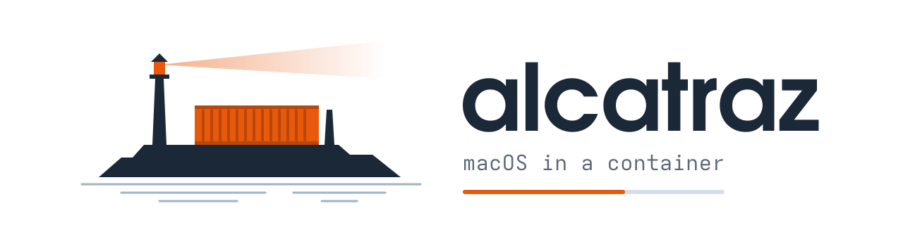
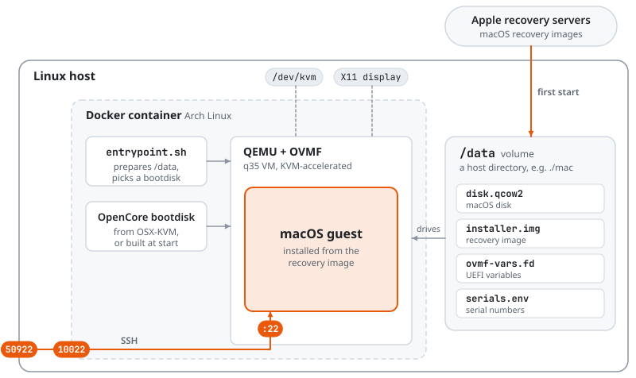
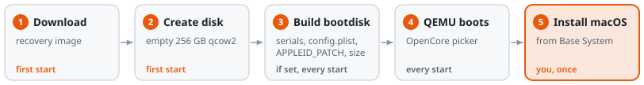

<div align="center">

<picture><source media="(prefers-color-scheme: dark)" srcset="assets/banner/banner-dark.svg"></picture>

Run macOS in a Docker container on any Linux machine with KVM.

[![Version][version-badge]][releases]
[![Image build][ci-badge]][ci]
[![macOS][macos-badge]](#pick-a-macos-version)
[![License][license-badge]][license]

---

<a href="#quickstart"><kbd>&nbsp;<br>&nbsp;&nbsp;&nbsp;Quickstart&nbsp;&nbsp;&nbsp;<br>&nbsp;</kbd></a> <a href="#usage"><kbd>&nbsp;<br>&nbsp;&nbsp;&nbsp;Usage&nbsp;&nbsp;&nbsp;<br>&nbsp;</kbd></a> <a href="#how-it-works"><kbd>&nbsp;<br>&nbsp;&nbsp;&nbsp;How it works&nbsp;&nbsp;&nbsp;<br>&nbsp;</kbd></a> <a href="#troubleshooting"><kbd>&nbsp;<br>&nbsp;&nbsp;&nbsp;Troubleshooting&nbsp;&nbsp;&nbsp;<br>&nbsp;</kbd></a> <a href="FAQ.md"><kbd>&nbsp;<br>&nbsp;&nbsp;&nbsp;FAQ&nbsp;&nbsp;&nbsp;<br>&nbsp;</kbd></a>

---

</div>

<p align="center">
<picture><source media="(prefers-color-scheme: dark)" srcset="assets/demo/demo-dark.svg"></picture>
</p>

## What it is

alcatraz is a Docker image that runs a macOS virtual machine with QEMU and KVM.
The image holds no macOS. On first start it downloads the installer from Apple's recovery servers and boots it.

- Installs any macOS from High Sierra (10.13) to Tahoe (26), chosen with `MACOS_VERSION`.
- Keeps the whole VM in one directory you mount, so you can delete a container and start another on the same disk.
- Forwards SSH, Screen Sharing and any other port you list to the host.
- Generates your own serial numbers for iMessage and iCloud with `SERIALS=random`.
- Passes USB devices, shared folders, extra disks and VNC through QEMU arguments.

Read [Is this legal?](FAQ.md#is-this-legal) before you use it.

## Why alcatraz?

A macOS VM on Linux needs QEMU, UEFI firmware, an OpenCore bootloader configured for virtual hardware, and an installer from Apple.
[OSX-KVM](https://github.com/kholia/OSX-KVM) provides the pieces. alcatraz packs them into one image and runs them with one command.

| | alcatraz | OSX-KVM by hand | Proxmox or libvirt |
|---|---|---|---|
| Setup | 1 `docker run` | Install QEMU, fetch macOS, run its scripts | Install a hypervisor, then port OSX-KVM's config |
| Where the VM lives | A directory you mount at `/data` | Wherever you put it | The hypervisor's storage |
| Best for | Trying macOS, throwaway or scripted VMs | Learning and changing the boot chain | A long-lived macOS VM |

## Requirements

- A Linux x86_64 host with KVM. `/dev/kvm` must exist, which needs virtualization turned on in the BIOS. Tested on Intel. On AMD, CI boots as far as the OpenCore picker; installing macOS there is untested.
- Docker, with your user in the `docker` group.
- An X11 display for the QEMU window. Xwayland works.
- About 60 GB free under `/var/lib/docker` for a fresh install, more with Xcode.
- 4 GB of RAM for the guest by default, plus what the host needs. Installs are more reliable with `-e RAM=8`.

Windows 11 reportedly works through WSL2 with nested virtualization, untested here. See [Can I run it on Windows?](FAQ.md#run-on-windows).

## Quickstart

1. Start the container. It downloads the installer, creates the disk in `./mac` and opens the QEMU window:

   ```bash
   docker run -it \
       --device /dev/kvm \
       -p 50922:10022 \
       -v ./mac:/data \
       -v /tmp/.X11-unix:/tmp/.X11-unix \
       -e "DISPLAY=${DISPLAY:-:0.0}" \
       ghcr.io/shbernal/alcatraz:latest
   ```

2. In the OpenCore picker, press Enter on the macOS Base System.
3. Open Disk Utility and erase the largest disk, around 256 GB. Leave the smaller ones alone.
4. Quit Disk Utility, choose Reinstall macOS and install to the disk you just erased.

The installer reboots several times and its time estimates mean nothing.
Pick the installed disk in the picker after each reboot.

### After installing

Leave the installer out with `-e INSTALLER=false`, then delete `mac/installer.img`.
Add `-e BOOT_PICKER=false` to boot the installed disk without the picker.

Any new container started with `-v ./mac:/data` picks up where the last one stopped.
The [data directory](docs/configuration.md#the-data-directory) lists what it holds.

### Pick a macOS version

The default is Tahoe. Add `-e MACOS_VERSION=<name>` for another:

| `MACOS_VERSION` | macOS | Tested |
|---|---|---|
| `high-sierra` | High Sierra (10.13) | |
| `mojave` | Mojave (10.14) | |
| `catalina` | Catalina (10.15) | |
| `big-sur` | Big Sur (11) | |
| `monterey` | Monterey (12) | |
| `ventura` | Ventura (13) | |
| `sonoma` | Sonoma (14) | |
| `sequoia` | Sequoia (15) | yes |
| `tahoe` | Tahoe (26) | yes |

Tested versions were installed from scratch and booted with the current OSX-KVM commit.
The others worked with Docker-OSX but haven't been installed with the current commit.
Tahoe is the last macOS for Intel Macs, so no newer version will run.

High Sierra and older also need `-e NETWORKING=vmxnet3`.

## Usage

### SSH into macOS

Turn on Remote Login in macOS (System Settings, General, Sharing). With `-p 50922:10022`, as in the quickstart:

```bash
ssh <macos-user>@localhost -p 50922
```

To forward more ports, see [Ports](docs/configuration.md#ports).

### Common settings

Every setting is an environment variable passed with `-e`. The ones you are most likely to change:

| Variable | Default | What it does |
|---|---|---|
| `MACOS_VERSION` | `tahoe` | macOS version to install. |
| `RAM` | `4` | Guest memory in GB, or `half` or `max` of the host's. |
| `CPUS` | `4` | Number of virtual CPUs. |
| `WIDTH`, `HEIGHT` | `1920`, `1080` | Screen resolution. |
| `SERIALS` | `default` | `random` generates your own [serial numbers](docs/configuration.md#serial-numbers) for iMessage and iCloud. |
| `PORTS` | `10022:22,5900` | Ports forwarded to the guest. |
| `QEMU_ARGS` | | Extra QEMU arguments, for USB devices, shared folders or VNC. |

All settings are in [docs/configuration.md](docs/configuration.md).

### Run it headless

Drop the X11 flags and serve the screen over VNC. See [Headless and VNC](FAQ.md#headless-and-vnc).

## How it works

<p align="center">
<picture><source media="(prefers-color-scheme: dark)" srcset="assets/diagrams/arch-dark.svg"></picture>
</p>

The image is Arch Linux with QEMU, OVMF firmware and OpenCore from a pinned OSX-KVM commit.
Every start runs the same steps and skips what `/data` already has.

<p align="center">
<picture><source media="(prefers-color-scheme: dark)" srcset="assets/diagrams/flow-dark.svg"></picture>
</p>

The disk is a qcow2 file, so it only takes the space macOS writes.
QEMU runs as an unprivileged user, and everything it writes goes to `/data`.

## Troubleshooting

| You see | Read |
|---|---|
| `error gathering device information while adding custom device "/dev/kvm"` | [KVM error](FAQ.md#kvm-error) |
| `gtk initialization failed`, or no window | [GTK initialization failed](FAQ.md#gtk-initialization-failed) |
| `permission denied` or `unknown server OS` from `docker` | [Docker errors](FAQ.md#docker-errors) |
| No disk to install on | [No disk to install on](FAQ.md#no-disk-to-install-on) |
| `cannot set up guest memory 'pc.ram'` | [Cannot allocate memory](FAQ.md#cannot-allocate-memory) |
| Pages of `ALSA lib` errors at start | Harmless, see [ALSA error](FAQ.md#alsa-error) |

## Lineage

alcatraz started in September 2026 as a hard fork of [Docker-OSX](https://github.com/sickcodes/Docker-OSX) by [Sick.Codes](https://sick.codes).
It builds on [OSX-KVM](https://github.com/kholia/OSX-KVM), [KVM-OpenCore](https://github.com/thenickdude/KVM-Opencore) and [OpenCore](https://github.com/acidanthera/OpenCorePkg), credited in [CREDITS.md](CREDITS.md).

Disks from Docker-OSX and alcatraz 1.x boot after a rename. [docs/upgrading.md](docs/upgrading.md) maps the old settings to the new ones.

## More

- [FAQ](FAQ.md): legality, platforms, USB, shared folders, audio, Apple ID
- [Configuration](docs/configuration.md): every setting, the data directory, serial numbers
- [Upgrading](docs/upgrading.md): from alcatraz 1.x or Docker-OSX
- [Contributing](CONTRIBUTING.md): build, layout and tests

<!-- badges -->
[version-badge]: https://img.shields.io/github/v/tag/shbernal/alcatraz?style=for-the-badge&label=version&labelColor=1f2328&color=e8590c
[releases]: https://github.com/shbernal/alcatraz/tags
[ci-badge]: https://img.shields.io/github/actions/workflow/status/shbernal/alcatraz/image.yml?branch=main&style=for-the-badge&logo=docker&logoColor=white&label=image&labelColor=1f2328&color=e8590c
[ci]: https://github.com/shbernal/alcatraz/actions/workflows/image.yml
[macos-badge]: https://img.shields.io/badge/macOS-10.13_to_26-e8590c?style=for-the-badge&logo=apple&logoColor=white&labelColor=1f2328
[license-badge]: https://img.shields.io/github/license/shbernal/alcatraz?style=for-the-badge&labelColor=1f2328&color=e8590c
[license]: LICENSE
